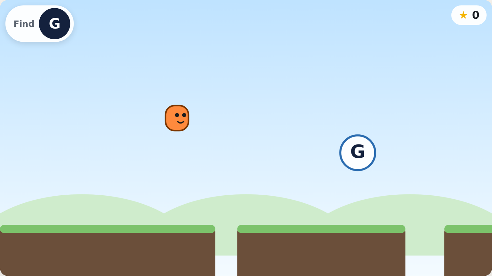
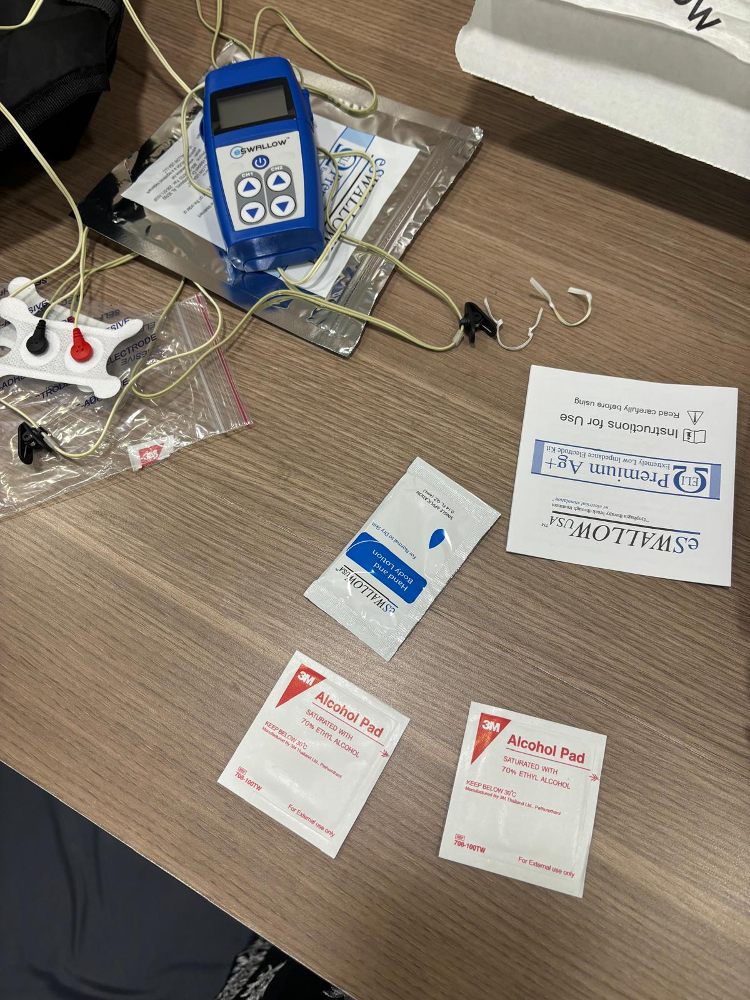
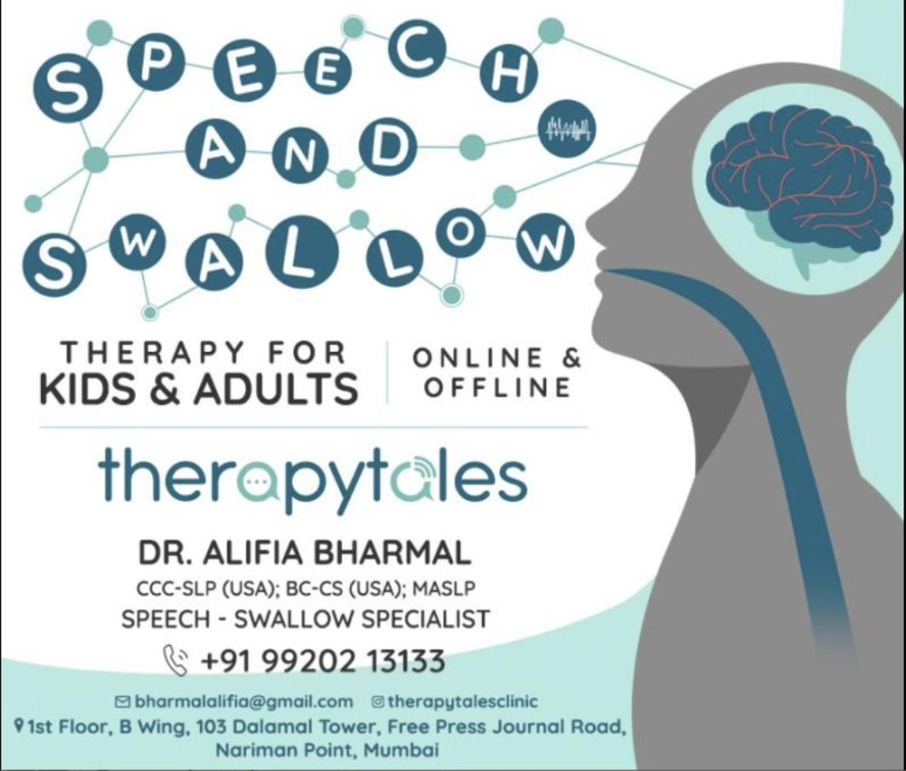

# NeuroLearner

**A learning platformer you play with your hand.** A webcam and whatever movement a child has is enough: no controller, no special hardware.

**[Play the live demo](https://tanhemdev.github.io/neurolearner/)** · works in Chrome, Edge and Safari on a laptop with a webcam, or with keys, touch or a single switch.

[](https://github.com/tanhemdev/neurolearner/actions/workflows/ci.yml)
[](https://github.com/tanhemdev/neurolearner/actions/workflows/pages.yml)

<p align="center">
  
</p>

## Why I built this

In 2024 I interned at [TherapyTales](https://www.instagram.com/therapytalesclinic/), a speech and swallow therapy clinic in Mumbai run by Dr. Alifia Bharmal. The kids I met there spent their sessions with tools adapted to them. Then they went home to learning games built for a child who can grip a controller or tap a small button fast.

NeuroLearner flips that. It starts by measuring the movement a child is comfortable with and stretches that range to cover the whole game. Steering is moving your hand left and right. Jumping is a pinch, opening your hand, or raising it: whichever that child can do.

<p align="center">
  
  
</p>

## What it does

- **Hand control through a webcam.** MediaPipe Hand Landmarker tracks 21 points on the hand, entirely in the browser. Video never leaves the device.
- **Calibrates to the child, not the other way round.** A 5-second calibration records the child's comfortable left-right range (5th to 95th percentile, so one stray frame can't stretch it). A small range still gives full control.
- **Three jump gestures:** pinch, open a closed hand, or raise the hand. Each uses hysteresis plus a 600 ms refractory period, so a hand hovering near the threshold doesn't fire ten jumps.
- **Tremor-friendly steering:** an adjustable still zone and smoothing.
- **No fail states.** Falling off a platform pops you back to the last safe spot. A wrong bubble bounces away gently. After two wrong touches the right one glows.
- **Learning content:** find letters, numbers or colors. Prompts are spoken aloud, and color bubbles always show the color's name, so color-blind players can play too.
- **Every input works:** arrow keys, touch buttons, a click or tap, or a single adaptive switch with **Auto-walk** (the game walks for you and the switch only jumps).
- **Built for sensory needs:** high-contrast mode, reduced motion (on automatically if the OS asks for it), sound and speech toggles, slow game speed.
- **Per-child profiles and a session summary** (stars, wrong touches, median time to find, minutes played). Both stay in the browser.

## How it works

```
webcam ──► MediaPipe Hand Landmarker (WASM, on-device) ──► 21 landmarks
                                                              │
         gestures.js:  mirror → palm center → smooth (EMA)    │
                       steer = calibrated range + still zone ◄┘
                       jump  = pinch | open | raise detector
                                  │
         game.js:      fixed rules, deterministic levels  ◄───┘   ◄── keys / touch / switch
                                  │
         render.js:    canvas world + DOM HUD (screen-reader friendly)
```

The gesture rules are pure functions with no camera or DOM dependencies. They're mirrored line for line in Python (`python/neurolearner/gestures.py`), and **both are tested against the same hand poses** in `fixtures/hands.json`, so the browser game and the desktop controller can't drift apart.

More detail: [docs/ARCHITECTURE.md](docs/ARCHITECTURE.md).

## Run it

**Browser game:** open the [live demo](https://tanhemdev.github.io/neurolearner/), or serve `web/` locally:

```bash
npx http-server web -p 8080      # then open http://localhost:8080
```

**Desktop controller (Python):** turns hand gestures into arrow-key and space presses, so a child can play this game or any keyboard game hands-free.

```bash
cd python
pip install -r requirements.txt
python -m neurolearner --jump pinch          # or --jump open / --jump raise
python -m neurolearner --dry-run             # show tracking without pressing keys
```

## Tests

| Suite | What it checks | Command |
|---|---|---|
| Gesture rules (JS) | pinch, open-hand and raise detection, calibration, steering, scale invariance | `npm test` |
| Game rules (JS) | deterministic levels, every gap is jumpable, respawn, scoring, level completion | `npm test` |
| Gesture rules (Python) | same poses, same expectations as the JS suite | `pytest python/tests` |
| End-to-end (browser) | plays the real page in Chromium with keys at desktop and phone widths, and in camera mode with a fake webcam plus a stand-in tracker that replays the fixture poses | `npm run test:e2e` |

All of them run in [GitHub Actions](.github/workflows/ci.yml) on every push. The demo deploys to GitHub Pages from `main`.

## Status and honest limits

- v1.0 is a working, tested prototype. **It has not been evaluated with children or clinicians yet.** The plan for that is in [docs/METRICS.md](docs/METRICS.md).
- Hand tracking quality depends on lighting and camera. The on-screen preview shows frames per second and detection time so an adult can see when tracking is struggling.
- The gesture thresholds are sensible defaults, not clinically tuned values.

## Docs

| Document | What's in it |
|---|---|
| [PRD](docs/PRD.md) | Problem, users, requirements, what's in and out of scope |
| [User research](docs/USER_RESEARCH.md) | What came from the clinic internship, the assumptions it led to, and how to test them |
| [Architecture](docs/ARCHITECTURE.md) | Modules, data flow, privacy, testing strategy |
| [Build log](docs/SPRINT_LOG.md) | What was built and when |
| [Metrics](docs/METRICS.md) | What's measured today, and the pilot metrics still to collect |

---

Built by [Tanya Hemdev](https://tanyahemdev.com), UC Berkeley (Cognitive Science + Data Science). If you work in pediatric therapy, special education or accessible games, I'd love to hear what breaks: tanyahemdev@berkeley.edu

For Kabir :)

https://github.com/user-attachments/assets/ac1bbfba-f5eb-4d4b-b578-a10d12a457d6
